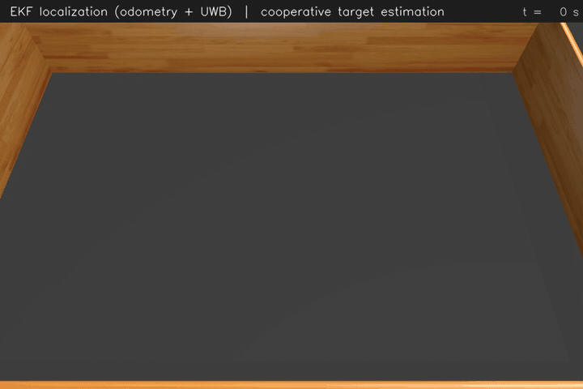
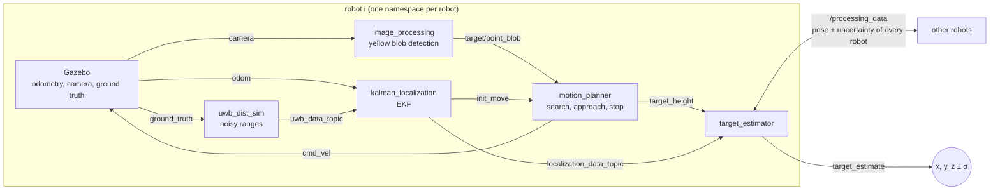
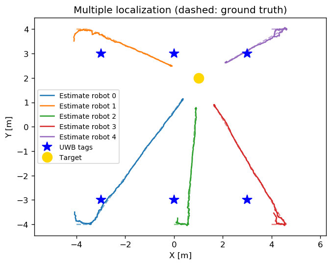
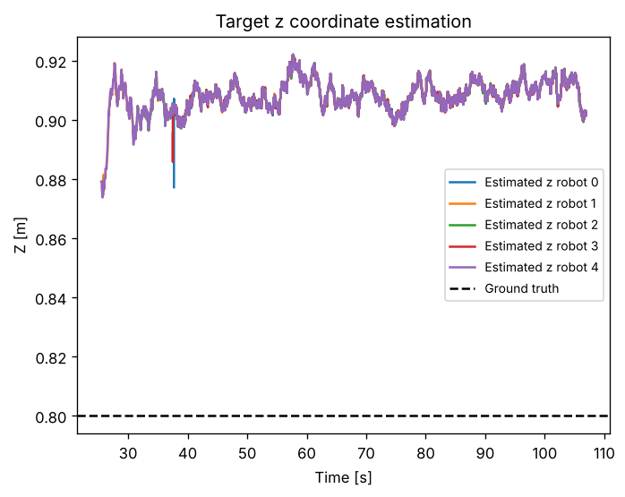
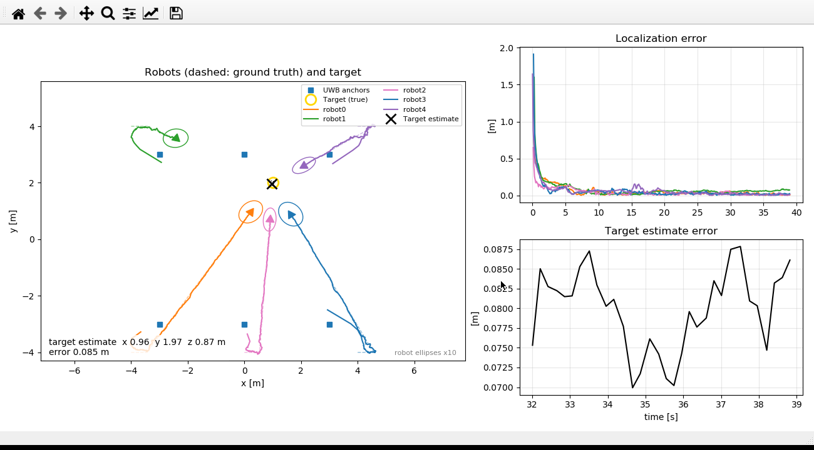

# Multi-robot UWB localization and cooperative target estimation

[](https://github.com/msterlini/uwb-ekf-cooperative-localization/actions/workflows/ci.yml)


[](LICENSE)

A ROS/Gazebo simulation of a team of unicycle robots in an indoor room. Each robot localizes itself with an **Extended Kalman Filter** that fuses wheel odometry with **UWB ranges** to anchors on the ceiling, then searches a target with its camera. The robots that reach the target share their pose and uncertainty, and every robot fuses them into a **3-D estimate of the target position**.

> **Branch `ros2`**: port of the project to ROS 2 Jazzy and Gazebo Harmonic, with the same estimation algorithms, robot behavior, scenario and parameters. The original ROS 1 Noetic / Gazebo Classic version is on [`main`](https://github.com/msterlini/uwb-ekf-cooperative-localization/tree/main).

Project of the course *Distributed Estimation for Robots and Vehicles* (2024). The full report, *Distributed unicycle system for the estimation of the 3D position of a target*, is in [`docs/report.pdf`](docs/report.pdf).



*Overview camera of a run in Gazebo Harmonic: estimated trajectories of the five robots (coloured trails) and cooperative estimate of the target (yellow cross).*

## How it works



**Ego-localization.** The state of each robot is $(x, y, \theta)$. The prediction step uses the unicycle model driven by the odometry increments; the correction step uses the distances $d_j = \lVert p - a_j \rVert$ to the UWB anchors $a_j$, whose noise grows with the distance ($\sigma_j = \sigma_0 + k\, d_j$). The ranges carry no information on $\theta$ while the robot is still, so the heading is first taken from the travelled direction and then corrected only while the robot moves.

**Target estimation.** A robot that reached the target is stopped and points at it, so the target lies on its bearing line $-\sin\theta_i\, x + \cos\theta_i\, y = -\sin\theta_i\, x_i + \cos\theta_i\, y_i$. The planar position is the weighted least-squares intersection of the lines of all the robots, each weighted with the uncertainty of the robot pose propagated to the line; the height comes from the elevation at which every camera sees the target.


*Illustration made from the recorded run: EKF localization of one robot, with the range corrections from the anchors and the 2-σ ellipse (×10), then the bearing lines of the five robots and their weighted least-squares intersection, next to the true target. Made with [Manim](https://www.manim.community/).*

## Results

Run of 5 robots and 6 anchors recorded in [`bagfiles/total_bag`](bagfiles) (MCAP), the same run of the GIF above, evaluated against the Gazebo ground truth with [`plots/scripts/uncertainty.py`](plots/scripts/uncertainty.py):

| Robot | RMSE x [m] | RMSE y [m] | RMSE θ [deg] | Mean predicted σ x, y [m] |
|---|---|---|---|---|
| 0 | 0.015 | 0.016 | 1.1 | 0.017, 0.020 |
| 1 | 0.017 | 0.016 | 0.9 | 0.022, 0.013 |
| 2 | 0.011 | 0.014 | 0.9 | 0.011, 0.022 |
| 3 | 0.020 | 0.022 | 3.1 | 0.017, 0.022 |
| 4 | 0.021 | 0.016 | 3.1 | 0.022, 0.016 |

All the robots reach the target. The cooperative estimate is **(0.987, 2.026, 0.902) m** against the true (1.00, 2.00, 0.80) m: 3 cm on the plane and 10 cm in height. The position errors are consistent with the covariance predicted by the filter, and the heading error stays at the value of the initial estimate instead of drifting.

Compared with the ROS 1 version (position RMSE 1–2 cm, target error 6.4 cm) the errors are of the same order. The trajectories start from the first estimate with a position uncertainty below 20 cm: before that the filter is still at its initial guess. In Gazebo Harmonic the odometry is computed from the wheels, so it drifts like a real one, while Gazebo Classic used the true velocity of the robot.

<p align="center">
  
  
</p>

## Running the simulation

The simulation opens Gazebo, the camera of a robot with the detected target and a live monitor of the estimates: map with true and estimated trajectories, covariance ellipses and the cooperative target estimate, plus the localization and target errors over time.

In Gazebo the blue cones are the fields of view of the robot cameras; the arrow at the bottom right expands the real time factor into simulation and real time.



It can run natively or in Docker, with the windows on the desktop or in the browser.

### Locally with ROS 2 Jazzy (Ubuntu 24.04)

```sh
mkdir -p ~/ros2_ws/src && cd ~/ros2_ws/src
git clone -b ros2 https://github.com/msterlini/uwb-ekf-cooperative-localization.git dist_project
cd ~/ros2_ws
rosdep update
rosdep install --from-paths src --ignore-src -y
colcon build
source install/setup.bash
ros2 launch dist_project sim.launch.py
```

### With Docker

No ROS installation needed, only Docker:

```sh
git clone -b ros2 https://github.com/msterlini/uwb-ekf-cooperative-localization.git
cd uwb-ekf-cooperative-localization
./run.sh          # Linux (and WSL2): windows on the desktop, with the GPU of the host
./run.sh web      # desktop in the browser at http://localhost:6080/vnc.html
```

| OS | Command | Result |
|---|---|---|
| Linux | `./run.sh` | windows on the desktop, GPU detected automatically |
| macOS (Docker Desktop) | `./run.sh` | desktop in the browser at http://localhost:6080/vnc.html |
| Windows (Docker Desktop) | `.\run.ps1` from PowerShell, or `./run.sh` inside WSL2 | desktop in the browser, or windows through WSLg |

The ROS images exist only for x86-64: on Apple Silicon Docker Desktop runs them through emulation, which works but is slower.

`run.sh` detects the GPU and adds the matching override in [`docker/`](docker): NVIDIA (requires [nvidia-container-toolkit](https://docs.nvidia.com/datacenter/cloud-native/container-toolkit/latest/install-guide.html)) or AMD/Intel through Mesa; without a GPU Gazebo renders on the CPU, which works but is slower. `GPU=nvidia|dri|none ./run.sh` forces a choice. The browser and headless modes run on a virtual display and always render on the CPU.

### Headless runs and results

Record a bag in `bagfiles/` without any window, then compute the error statistics and the figures in `plots/`:

```sh
# Docker
DURATION=300 BAG_NAME=my_run ./run.sh headless
pip install rosbags matplotlib
python3 plots/scripts/uncertainty.py bagfiles/my_run --save

# Native
ros2 launch dist_project sim.launch.py gui:=false record:=true bag_name:=my_run
python3 plots/scripts/uncertainty.py bagfiles/my_run --save
```

The bags are recorded in MCAP format; the analysis scripts read them with [rosbags](https://gitlab.com/ternaris/rosbags), which also reads the ROS 1 bags of the report and needs no ROS installation.

Launch arguments of `sim.launch.py`: `gui` (default `true`), `monitor` (live monitor, default `true`), `record`, `bag_name`, `bag_dir`, `overview_camera` (fixed camera above the room on `/overview_camera/image_raw`), `camera_rate` (frame rate of the robot cameras, default 30; Gazebo Harmonic renders the cameras in lockstep with the physics, so without a GPU a lower rate keeps the simulation fast, and `run.sh` uses 10 in that case). All the parameters of the filter and of the sensors are in [`config/params.yaml`](config/params.yaml).

### Changing the scenario

The number and the positions of robots, anchors and target are read from the csv files in [`coordinates/`](coordinates): adding a line adds a robot or an anchor, no code changes needed.

### Tests

The estimation code is plain Python/NumPy in [`src/dist_project`](src/dist_project) and is tested without ROS:

```sh
pip install numpy pytest
pytest
```

## Repository structure

| Folder | Content |
|---|---|
| `scripts/` | ROS nodes, see [scripts/README.md](scripts/README.md) |
| `src/dist_project/` | EKF, bearing-only triangulation and anchor lookup |
| `launch/` | `sim.launch.py`: Gazebo, spawning from the csv files, ROS-Gazebo bridge and the nodes of every robot |
| `config/` | `params.yaml`, parameters of all the nodes |
| `coordinates/` | spawn positions of robots, anchors and target |
| `urdf/`, `mesh/`, `models/`, `worlds/` | robot description, room, target and Gazebo world |
| `msg/` | custom messages `UwbData` and `RobotData` |
| `bagfiles/` | recorded simulations |
| `plots/` | scripts and figures of the results |
| `test/` | unit tests |

## Using it as a base

The project was built to be a starting point for other course projects: the scene is generated from the csv files, every robot runs in its own namespace and the estimation code is separated from ROS. If you use it, feel free to open an issue to let me know.
