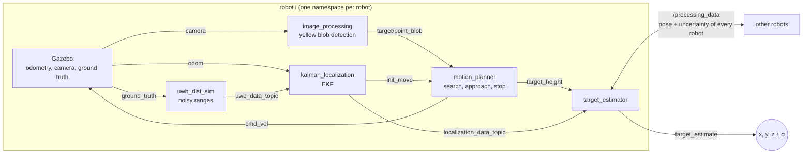

# Multi-robot UWB localization and cooperative target estimation

[](https://github.com/msterlini/uwb-ekf-cooperative-localization/actions/workflows/ci.yml)


[](LICENSE)

A ROS/Gazebo simulation of a team of unicycle robots in an indoor room. Each robot localizes itself with an **Extended Kalman Filter** that fuses wheel odometry with **UWB ranges** to anchors on the ceiling, then searches a target with its camera. The robots that reach the target share their pose and uncertainty, and every robot fuses them into a **3-D estimate of the target position**.

Project of the course *Distributed Estimation for Robots and Vehicles* (2024). The full report, *Distributed unicycle system for the estimation of the 3D position of a target*, is in [`docs/report.pdf`](docs/report.pdf).


*Overview camera of a run: estimated trajectories of the five robots (coloured trails) and cooperative estimate of the target (yellow cross).*

## How it works



**Ego-localization.** The state of each robot is $(x, y, \theta)$. The prediction step uses the unicycle model driven by the odometry increments; the correction step uses the distances $d_j = \lVert p - a_j \rVert$ to the UWB anchors $a_j$, whose noise grows with the distance ($\sigma_j = \sigma_0 + k\, d_j$). The ranges carry no information on $\theta$ while the robot is still, so the heading is first taken from the travelled direction and then corrected only while the robot moves.

**Target estimation.** A robot that reached the target is stopped and points at it, so the target lies on its bearing line $-\sin\theta_i\, x + \cos\theta_i\, y = -\sin\theta_i\, x_i + \cos\theta_i\, y_i$. The planar position is the weighted least-squares intersection of the lines of all the robots, each weighted with the uncertainty of the robot pose propagated to the line; the height comes from the elevation at which every camera sees the target.


*Illustration made from the recorded run: EKF localization of one robot, with the range corrections from the anchors and the 2-σ ellipse (×10), then the bearing lines of the five robots and their weighted least-squares intersection, next to the true target. Made with [Manim](https://www.manim.community/); source in [msterlini/website](https://github.com/msterlini/website/tree/main/manim).*

## Results

Run of 5 robots and 6 anchors recorded in [`bagfiles/total_bag.bag`](bagfiles), evaluated against the Gazebo ground truth with [`plots/scripts/uncertainty.py`](plots/scripts/uncertainty.py):

| Robot | RMSE x [m] | RMSE y [m] | RMSE θ [deg] | Mean predicted σ x, y [m] |
|---|---|---|---|---|
| 0 | 0.016 | 0.014 | 4.9 | 0.017, 0.019 |
| 1 | 0.015 | 0.009 | 1.2 | 0.022, 0.012 |
| 2 | 0.010 | 0.014 | 1.7 | 0.008, 0.021 |
| 3 | 0.013 | 0.013 | 2.4 | 0.015, 0.020 |
| 4 | 0.017 | 0.014 | 5.2 | 0.021, 0.015 |

All the robots reach the target. The cooperative estimate is **(0.965, 1.952, 0.825) m** against the true (1.00, 2.00, 0.80) m, an error of **6.4 cm**. The position errors are consistent with the covariance predicted by the filter, and the heading error stays at the value of the initial estimate instead of drifting.

<p align="center">
  
  
</p>

## Running the simulation

The simulation opens Gazebo, the camera of a robot with the detected target and PlotJuggler (layouts in [`plotjuggler/`](plotjuggler)). It can run natively or in Docker, with the windows on the desktop or in the browser.

### Locally with ROS Noetic (Ubuntu 20.04)

```sh
mkdir -p ~/catkin_ws/src && cd ~/catkin_ws/src
git clone https://github.com/msterlini/uwb-ekf-cooperative-localization.git dist_project
cd ~/catkin_ws
rosdep update --include-eol-distros
rosdep install --from-paths src --ignore-src -y
catkin_make
source devel/setup.bash
roslaunch dist_project init.launch
```

### With Docker

No ROS installation needed, only Docker:

```sh
git clone https://github.com/msterlini/uwb-ekf-cooperative-localization.git
cd uwb-ekf-cooperative-localization
docker compose up web          # desktop in the browser: http://localhost:6080/vnc.html (any OS)
```

On a Linux host with an X server the windows can also open directly on the desktop:

```sh
xhost +local:docker
docker compose up sim
```

### Headless runs and results

Record a bag in `bagfiles/` without any window, then compute the error statistics and the figures in `plots/`:

```sh
# Docker
DURATION=300 BAG_NAME=my_run docker compose run --rm headless
docker compose run --rm -v ./plots:/catkin_ws/src/dist_project/plots headless \
    python3 src/dist_project/plots/scripts/uncertainty.py src/dist_project/bagfiles/my_run.bag --save

# Native
roslaunch dist_project init.launch gui:=false record:=true bag_name:=my_run
python3 plots/scripts/uncertainty.py bagfiles/my_run.bag --save
```

Launch arguments of `init.launch`: `gui` (default `true`), `plotjuggler` (default `true`, set it to `false` if PlotJuggler is not installed), `record`, `bag_name`, `overview_camera` (fixed camera above the room on `/overview_camera/image_raw`). All the parameters of the filter and of the sensors are in [`launch/init.launch`](launch/init.launch).

### Changing the scenario

The number and the positions of robots, anchors and target are read from the csv files in [`coordinates/`](coordinates): adding a line adds a robot or an anchor, no code changes needed.

### Tests

The estimation code is plain Python/NumPy in [`src/dist_project`](src/dist_project) and is tested without ROS:

```sh
pip install numpy pytest
pytest
```

## Repository structure

| Folder | Content |
|---|---|
| `scripts/` | ROS nodes, see [scripts/README.md](scripts/README.md) |
| `src/dist_project/` | EKF, bearing-only triangulation and anchor lookup |
| `launch/` | `init.launch` (whole simulation), `start_nodes.launch` (nodes of one robot) |
| `coordinates/` | spawn positions of robots, anchors and target |
| `urdf/`, `mesh/`, `models/`, `worlds/` | robot description, room, target and Gazebo world |
| `msg/` | custom messages `uwb_data` and `robot_data` |
| `bagfiles/` | recorded simulations |
| `plots/` | scripts and figures of the results |
| `plotjuggler/` | PlotJuggler layouts |
| `test/` | unit tests |

## Using it as a base

The project was built to be a starting point for other course projects: the scene is generated from the csv files, every robot runs in its own namespace and the estimation code is separated from ROS. If you use it, feel free to open an issue to let me know.
